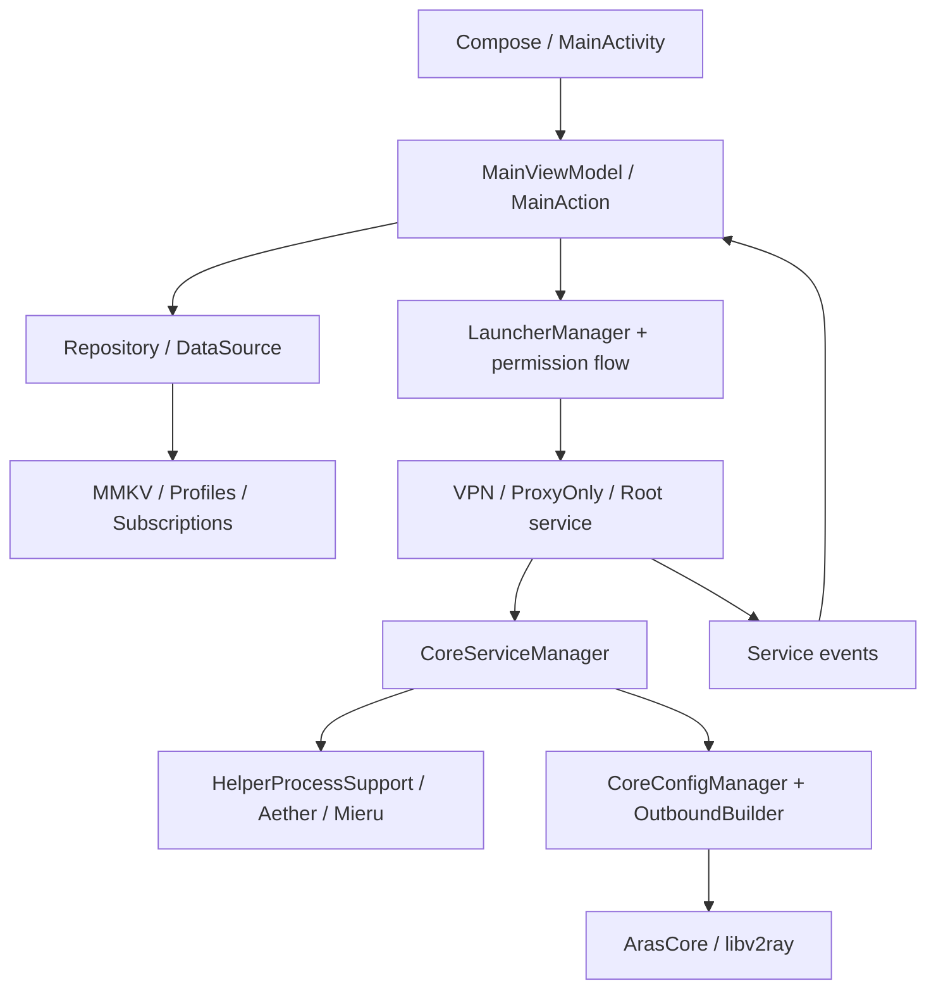
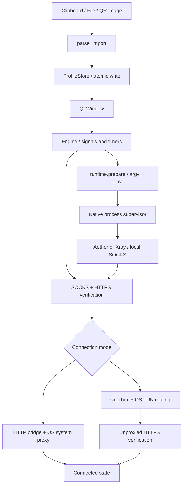
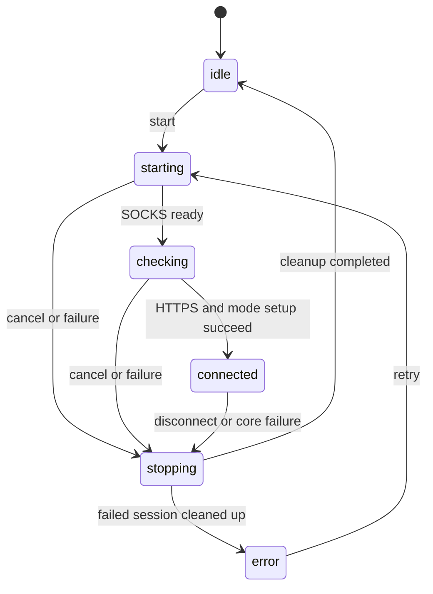

# معماری و جریان اجرای اتصال

[فهرست مستندات](README.md) · [معماری](ARCHITECTURE.md) · [راهنمای توسعه](DEVELOPMENT.md)

## مرزهای اصلی سیستم

| لایه | کار آن | نمونهٔ وابستگی نامناسب |
|---|---|---|
| نمایش | دریافت اکشن، نمایش state، دسترسی‌پذیری و طراحی | اجرای مستقیم یک فرمان شبکه از Composable یا paintEvent |
| کاربرد و lifecycle | انتخاب پروفایل، مجوز، آغاز/لغو/توقف و بازیابی | سبزکردن UI صرفاً به دلیل ایجاد یک PID |
| تبدیل کانفیگ | parse، اعتبارسنجی، ساخت مدل و config/argv | اجرای متن کاربر با shell |
| هستهٔ شبکه | رمزنگاری، اتصال به peer و ارائهٔ SOCKS/TUN | نسبت‌دادن قابلیت یک هسته به تمام محصولات |
| ادغام OS | VpnService، ip/nft، WinINET/Wintun، process containment | استفاده از API لینوکس در نسخهٔ ویندوز |
| ذخیره‌سازی | پروفایل، هویت و snapshot خصوصی | کپی دادهٔ runtime به منابع installer |

## اندروید: State/Action و ViewModel

صفحهٔ اصلی الگوی state و action با ViewModel دارد؛ StateFlow وضعیت را به
Compose می‌رساند. Repository/DataSource دسترسی داده را از بخش بزرگی از منطق
صفحه جدا می‌کنند. مدیرهای config، سرویس و native مسئولیت‌های مستقل دارند؛
تمام پروژه را نباید بدون بررسی، یک Clean Architecture خالص و بدون وابستگی
Android Context توصیف کرد.

### مسیر دادهٔ TUN در اندروید

دو حالت مهم در کد وجود دارد:

- اگر HEV انتخاب شده باشد، سرویس descriptor مربوط به VPN را به مسیر
  `TProxyService` / tun2socks می‌دهد و `tunFd = 0` به هسته ارسال می‌شود.
- در مسیر غیر HEV، descriptor به `coreController.startLoop` تحویل داده می‌شود
  و HEV به‌عنوان خوانندهٔ دوم آن آغاز نمی‌شود.

قاعدهٔ حیاتی: **هر TUN فقط یک خواننده داشته باشد.** افزودن WireGuard یا
AmneziaWG نباید یک خوانندهٔ موازی روی همان FD ایجاد کند. هستهٔ اصلی outbound
را شماره‌گیری می‌کند و helperهای Aether/Mieru به‌صورت SOCKS محلی در مسیر آن
قرار می‌گیرند. `VpnService.protect()` و تنظیمات bypass باید از برگشت اتصال
بالادستی به VPN خود برنامه جلوگیری کنند.

### ساخت کانفیگ و نقش API

1. لینک/QR/فایل توسط `fmt/` و مدیر import به مدل پروفایل تبدیل می‌شود.
2. اطلاعات پروفایل، route/DNS و وابستگی‌های chain در سازنده‌های config ترکیب می‌شوند.
3. JSON هستهٔ اصلی و آرگومان‌های هستهٔ جانبی در خود برنامه ساخته می‌شوند.
4. Aether در صورت نیاز ثبت هویت WARP و ارتباط با endpoint را انجام می‌دهد؛ `AetherIdentityManager` فایل‌های هویت هسته را مدیریت می‌کند.
5. FreeSub یک منبع ازپیش‌منتشرشده را از GitHub Raw می‌خواند؛ API عمومیِ تبدیل هر درخواست به VLESS نیست.

بنابراین دانلود اشتراک، ثبت هویت، اسکن endpoint و ساخت config چهار عملیات
مجزا هستند. موفقیت یکی، موفقیت سه مورد دیگر یا آزادبودن اینترنت را تضمین نمی‌کند.

## دسکتاپ: رابط Qt، Engine و سرپرست پردازش

در دسکتاپ، `ui.py` نمایش را مدیریت می‌کند و `Engine` با سیگنال، تایمر، QProcess
و QtNetwork کنترل اتصال را به عهده دارد. `profiles.py` و `runtime.py` به‌ترتیب
مدل ورودی و برنامهٔ اجرای هسته را تولید می‌کنند. helperها از همان entry point
ولی با آرگومان داخلی و در پردازش مستقل اجرا می‌شوند.

`Connected` نتیجهٔ orchestration و آزمون است؛ خود helper تصمیم نهایی دربارهٔ
موفقیت HTTPS رابط را نمی‌گیرد. اطلاعات کشور، فقط در صورت دریافت پاسخ trace
قابل مقایسه است؛ نبود کشور، یک مکان تضمین‌شده تولید نمی‌کند.

### ماشین حالت Engine

`testing` پرچم جداست: آزمون دستی در حالت connected، اتصال را به دلیل یک پاسخ
ناموفق لزوماً متوقف نمی‌کند. هر callback شبکه باید cancellation، reply قبلی و
توقف هم‌زمان را در نظر بگیرد. عبارت status در Android، همین ماشین حالت دسکتاپ نیست.

## تفاوت لایهٔ OS در دو دسکتاپ

| موضوع | لینوکس | ویندوز |
|---|---|---|
| state | `~/.config/tesla-vpn` | `%LOCALAPPDATA%\TeslaVpn` |
| مجوز TUN | helper با pkexec | اجرای دوبارهٔ کل برنامه با UAC |
| دسترسی هستهٔ upstream | UID کاربر + GID اختصاصی | در سشن TUN، همان context مدیر برنامه |
| استثناکردن upstream | mark روی socketهای GID + ip rule | route rule بر اساس مسیر دقیق executable |
| API مسیریابی | iproute2 / nftables / sing-box | sing-box / Wintun / IP Helper API |
| بررسی مسیر | `ip route get` برای هر دو خانواده | `GetBestInterfaceEx` و نام interface |
| توقف درخت پردازش | session/process group و parent-death signal | Job Object و stdin EOF |
| پراکسی سیستم | KDE + GNOME/GSettings | connection options کاربر در WinINET |
| DNS | rule صریح port 53 به dns-out و DoH | hijack-dns با DoH server در sing-box 1.12 |

فرمت config sing-box قدیمی لینوکس را در ویندوز 1.12 کپی نکنید؛ schema DNS و
نام فیلدهای آدرس تغییر کرده‌اند. همین‌طور pkexec، nft و killpg معادل WinINET،
Job Object و UAC نیستند.

## قرارداد پروفایل و هویت

- ورودی متنی به `Profile` نوع `aether` یا `xray` تبدیل می‌شود.
- ورودی حداکثر ۸ MiB است؛ بعضی محدودیت‌ها، مانند تعداد کاراکتر YAML اندروید، جدا هستند.
- در batch، parser دسکتاپ اولین مورد پشتیبانی‌شده را نگه می‌دارد.
- `private_write` فایل موقت را می‌نویسد و با replace منتشر می‌کند؛ parse ناموفق نباید دادهٔ قبلی را خراب کند.
- `runtime.prepare` با fingerprint پروفایل، پوشهٔ account می‌سازد؛ فایل هویت موجود را بی‌دلیل بازنویسی نمی‌کند.
- پورت WARP داخلی و پورت نهایی سایفون یکسان نیستند؛ probe و route باید به listener نهایی بروند.
- شمارهٔ `version: 1` در چند مدل JSON، آن‌ها را یک قالب واحد نمی‌کند؛ envelope، نوع و فیلدهای هویت باید اعتبارسنجی شوند.

## مرز ذخیره‌سازی و بستهٔ اجرایی

| داده | محل منطقی | قرارداد |
|---|---|---|
| مدل پروفایل و انتخاب Android | MMKV در فضای خصوصی همان applicationId | هویت Debug و Release و مهاجرت selection جدا بررسی شود |
| هویت Aether در Android | workDir مبتنی بر `context.filesDir` و فایل‌های TOML مدیر هویت | فایل هویت با تنظیمات نمایشی پروفایل یکی نیست |
| پروفایل دسکتاپ | `profile.json` در state کاربر | UTF-8، جایگزینی اتمی و تک‌پروفایل |
| هویت دسکتاپ | پوشهٔ `accounts/` در state | تداوم هویت معتبر در reconnect؛ خارج از سورس و installer |
| snapshot پراکسی | `proxy-recovery.json` | تا بازیابی موفق باقی بماند؛ شامل اطلاعات خصوصی محیط کاربر است |
| asset و هستهٔ توزیع | منابع ثابت برنامه و `cores/` آماده‌شده | بدون account، با نسخه، checksum و license |

وجود محدودیت دسترسی فایل، جای بررسی دامنهٔ backup، لاگ، clipboard و share را
نمی‌گیرد. مسیرهای واقعی state و فایل‌های خصوصی وارد نمونهٔ مستندات نشوند.

## توقف و بازیابی بخشی از معماری است

توقف باید childها، routeها، DNS و تنظیمات OS را پوشش دهد، نه فقط رنگ دکمه را.
در failure نیز cleanup اجرا می‌شود. اگر بازیابی تنظیمات شکست خورد، backup نباید
پیش از موفقیت حذف شود. EOF والد یک مسیر واقعی shutdown است و باید آزمون شود.
در اندروید، مرگ helper باید سرویس و state را به وضعیت قابل بازیابی برگرداند.

## منابع کد

- [دو مسیر TUN و تک‌خواننده‌بودن FD](https://github.com/sadrarahbar/ArasClient/blob/e48baa88b8d3a6bc9d2ffb70ae7e4c4de566d278/app/src/main/java/com/aras/client/service/CoreVpnService.kt)
- [ترتیب helper و native core](https://github.com/sadrarahbar/ArasClient/blob/e48baa88b8d3a6bc9d2ffb70ae7e4c4de566d278/app/src/main/java/com/aras/client/core/CoreServiceManager.kt)
- [مدیریت هویت و ثبت‌نام توسط هسته](https://github.com/sadrarahbar/ArasClient/blob/e48baa88b8d3a6bc9d2ffb70ae7e4c4de566d278/app/src/main/java/com/aras/client/core/aether/AetherIdentityManager.kt)
- [منبع FreeSub](https://github.com/sadrarahbar/ArasClient/blob/e48baa88b8d3a6bc9d2ffb70ae7e4c4de566d278/app/src/main/java/com/aras/client/handler/FreeSubManager.kt)
- [ماشین حالت و probe دسکتاپ](https://github.com/sadrarahbar/ArasClient/blob/94bcb7bf6485b4ee2c092f55f52f44e5606ff5ea/linux/tesla_vpn/engine.py)
- [سرپرست و routeهای ویندوز](https://github.com/sadrarahbar/ArasClient/blob/a3d070650bde142f5031641afa21808f87080a56/windows/tesla_vpn/tun.py)
