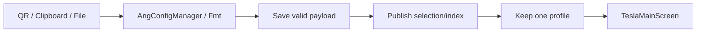

# برنچ Android-Client — Tesla Vpn برای گوشی و باکس

[فهرست مستندات](README.md) · [معماری](ARCHITECTURE.md) · [راهنمای توسعه](DEVELOPMENT.md)

> مرجع کد: `ea250e6` · نسخه: `1.8.71` · محصول: رابط سادهٔ تک‌کانفیگ روی زیرساخت اندروید.

## هدف برنچ

این برنچ برای استفادهٔ سادهٔ روزمره ساخته شده است: واردکردن یک کانفیگ، اتصال
با دکمهٔ مرکزی، مشاهدهٔ وضعیت و آزمون اینترنت. رابط مدیریتی اصلی در
`LegacyMainScreen` و بسیاری از قابلیت‌های قبلی در کد باقی مانده‌اند؛ پنهان‌شدن
آن‌ها در Tesla به معنی حذف backend یا در دسترس‌بودن آن‌ها در صفحهٔ جدید نیست.

`AppConfig.SINGLE_PROFILE_MODE = true` انتخاب این تجربه را کنترل می‌کند.
برگرداندن سادهٔ این ثابت، جای طراحی و آزمون سیاست دادهٔ چندکانفیگی را نمی‌گیرد.

## تجربهٔ کاربری و طراحی

| ویژگی | رفتار فعلی |
|---|---|
| نام نمایشی و فایل نصب | Tesla Vpn / `TeslaVpn_...apk` |
| شناسهٔ داخلی | همان `com.aras.client`؛ Debug با پسوند `.debug` |
| فریم طراحی | Figma `15:183`؛ مبنای ۴۵۱×۸۵۲، با مقیاس یکنواخت در فضای امن دستگاه |
| اندازهٔ دکمه در فریم | قطر ۲۳۱ واحد طراحی؛ لوگوی SVG اصلی متناسب با آن |
| پس‌زمینه | `#0F1626` |
| قطع / اتصال در جریان / متصل | `#E74E62` / `#F4BE63` / `#35D88A` |
| هاله | همان رنگ متحرک دکمه؛ حفظ افت و شفافیت گرادینت |
| بدون کانفیگ | راهنمای ورود و دکمهٔ Import |
| جایگزینی | Bottom Sheet با QR، کلیپ‌بورد و فایل؛ علامت `+` کنار گزینه‌ها |
| وضعیت و تست | زیر دکمه؛ آزمون اینترنت مجزا از نشانهٔ running سرویس |

`active` در UI از `isRunning && !isConnecting` به دست می‌آید؛ بنابراین سبزشدن
دکمه به‌تنهایی گواه آزمون مستقل HTTPS نیست. این تفاوت با Engine دسکتاپ مهم است.

[فریم طراحی Android در Figma](https://www.figma.com/design/gKL0JdFJt1yzb1DuWeAnyu/Tesla-VPN?node-id=15-183)
ممکن است بعداً تغییر کند؛ اعداد این سند به کد کامیت مرجع مربوط‌اند.

## استک

استک Kotlin، Compose، Material 3، ViewModel/StateFlow، MMKV، Gson، Coroutines،
WorkManager و هسته‌های native با `main` مشترک است. نسخه‌های اصلی در
[راهنمای main](BRANCH-MAIN.md) و Version Catalog همان برنچ قابل بررسی‌اند.
این برنچ علاوه بر آن:

- از `androidsvg-aar:1.4` برای نمایش SVG استفاده می‌کند.
- چهار نمونهٔ ثابت Geologica با وزن‌های ۳۰۰، ۴۰۰، ۵۰۰ و ۷۰۰ را در `res/font/` دارد؛ وابسته به پشتیبانی فونت متغیر Android 8+ نیست.
- هالهٔ رسمی صادرشده از Figma را به‌صورت PNG نمایش می‌دهد؛ `ColorMatrix` رنگ آن را عوض می‌کند تا تفاوت interpolation رندر SVG اندروید، طرح را پررنگ‌تر نکند.
- لوگو، فونت و فایل مجوز را محلی بسته‌بندی می‌کند؛ اجرای UI نیاز به Figma یا دانلود تصویر ندارد.

## سیستم‌عامل و بسته‌های CPU

حداقل Android 7.0 / API 24، با `compileSdk/targetSdk = 37`.
برای گوشی آزمایش‌شده، خروجی `arm64-v8a` ساخته شده است. برای باکس ARM، بستهٔ
Universal شامل `armeabi-v7a` و `arm64-v8a` است؛ انتخاب بر اساس CPU تبلیغ‌شده
به‌تنهایی کافی نیست، چون firmware ممکن است ۳۲ بیتی باشد.
Android 9 باکس از نظر حداقل API در محدوده است؛ تست نصب و اتصال روی همان باکس
همچنان لازم است. کیفیت کنترل با ریموت، مصرف حافظه و نمایش روی تلویزیون موضوع آزمون جداست.

## معماری تک‌کانفیگ



- `SingleProfilePolicy.choose` انتخاب معتبر فعلی را ترجیح می‌دهد؛ در غیر این صورت اولین مورد را برمی‌گزیند.
- محدودیت فقط فیلتر UI نیست؛ `MmkvManager` و مسیر انتشار پروفایل نیز آن را اعمال می‌کنند.
- در batch، اولین کانفیگ معتبر نگهداری می‌شود؛ ورود ناموفق نباید کانفیگ قبلی را حذف کند.
- دادهٔ جدید پیش از حذف موارد جایگزین‌شده ذخیره و منتشر می‌شود.
- روی دادهٔ نسخهٔ قدیمی، مهاجرت تک‌کانفیگی باید selection معتبر را حفظ کند.
- دریافت خودکار Free و زمان‌بندی‌های مربوط در این حالت غیرفعال‌اند؛ کد اصلی حذف نشده است.

## پروتکل‌ها و دسترسی UI

backend نوع‌های اندرویدی `main` را حفظ می‌کند و Import همچنان از parserهای
پروژه استفاده می‌کند. اما رابط Tesla صفحهٔ ساخت دستی، فهرست، گروه و منوی
مدیریت ندارد. وجود parser یا handler، تضمین نمی‌کند همان عملیات از UI Tesla
قابل انجام باشد. `.arasc` محلی، از جمله مسیر دریافت رمز، در اندروید باقی مانده است.

قابلیت **Export to Nekoray** عمداً در کد اندروید حفظ شده است؛ ابزارهای اجرایی
لینوکس و مستندات نصب آن از این برنچ جدا شده‌اند. دسترسی به Share در رابط قدیمی
را با وجود یک دکمهٔ Share در صفحهٔ اصلی Tesla یکی ندانید.
قابلیت Share to V2Box جزو این محصول فعلی نیست.

## ساخت گوشی و اندروید باکس

```bash
git switch Android-Client
./tools/build-debug.sh
./gradlew :app:testDebugUnitTest --console=plain
```

برای APK واحد ARM32+ARM64 در محیط Bash:

```bash
ABI_FILTERS='armeabi-v7a;arm64-v8a' ./tools/build-debug.sh -PUNIVERSAL_APK=true
```

معادل مستقیم Gradle، پس از آماده‌بودن Java و SDK:

```bash
./gradlew :app:assembleDebug '-PABI_FILTERS=armeabi-v7a;arm64-v8a' -PUNIVERSAL_APK=true --console=plain
```

خروجی‌ها در `app/build/outputs/apk/debug/` هستند. فایل Universal روی باکس ARM
با firmware مناسب نصب می‌شود؛ این بسته مخصوص x86 نیست. نصب با `adb install -r`
داده را در صورت پذیرش امضا حفظ می‌کند؛ ناسازگاری امضا یا versionCode را با حذف
دادهٔ کاربر دور نزنید. شمارهٔ versionCode خروجی‌های ABI متفاوت است؛ تعویض
Universal و ABI-specific ممکن است محدودیت downgrade داشته باشد.

## راهنمای تغییر UI و داده

1. تغییر ظاهر از `TeslaMainScreen.kt` آغاز شود؛ مدیر سرویس و parser را برای تغییر اندازهٔ دکمه دست‌کاری نکنید.
2. رنگ دکمه و هاله یک منبع وضعیت مشترک داشته باشند؛ رنگ ثابت ثانویه ایجاد نکنید.
3. فایل‌های اصلی Figma و مجوز فونت حفظ شوند؛ تصویر کامل صفحه را به‌جای UI تعاملی قرار ندهید.
4. حداقل Android 7 و نمایش بدون دوربین، با جهت RTL/LTR و مقیاس فونت بررسی شوند.
5. هر تغییر single-profile با سناریوی دادهٔ قدیمی، ورود نامعتبر و ورود چندتایی آزمایش شود.

## آزمون ثبت‌شده و کارهای بعدی

در توسعهٔ این نسخه، APK روی گوشی نصب و اتصال توسط کاربر تأیید شده و ۳۳۸ تست
واحد در ساخت اندروید موفق بوده‌اند. این عدد گزارش آن اجراست، نه قرارداد ثابت
تعداد تست‌های آینده. Universal ساخته شده، اما ساخت آن معادل اثبات اتصال روی
تمام باکس‌ها نیست. بهینه‌سازی TV/ریموت، آزمون API 24 و حذف دادهٔ حساس از لاگ‌ها
در [نقشهٔ راه](ROADMAP.md) اولویت دارند.

## منابع کد

- [رابط، اندازه‌ها و هاله](https://github.com/sadrarahbar/ArasClient/blob/ea250e6e47c3c9773b67e5451c29aac74c3410cc/app/src/main/java/com/aras/client/ui/main/TeslaMainScreen.kt)
- [سیاست ذخیره‌سازی تک‌کانفیگ](https://github.com/sadrarahbar/ArasClient/blob/ea250e6e47c3c9773b67e5451c29aac74c3410cc/app/src/main/java/com/aras/client/handler/MmkvManager.kt)
- [انتخاب کانفیگ مهاجرت](https://github.com/sadrarahbar/ArasClient/blob/ea250e6e47c3c9773b67e5451c29aac74c3410cc/app/src/main/java/com/aras/client/handler/SingleProfilePolicy.kt)
- [ساخت Universal و منابع native](https://github.com/sadrarahbar/ArasClient/blob/ea250e6e47c3c9773b67e5451c29aac74c3410cc/app/build.gradle.kts)
- [مجوزها و ویژگی‌های دستگاه](https://github.com/sadrarahbar/ArasClient/blob/ea250e6e47c3c9773b67e5451c29aac74c3410cc/app/src/main/AndroidManifest.xml)
