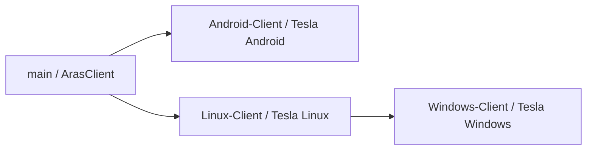

# راهنمای فنی ArasClient و Tesla Vpn

> مستندات فارسیِ چهار برنچ محصول — وضعیت بررسی‌شده در **۲ نوامبر ۲۰۲۶**.
> این مجموعه در `main` نگهداری می‌شود؛ هر برنچ، برنامه و فرایند ساخت مستقل خود را دارد.

## از کجا شروع کنیم؟

| نیاز شما | مسیر مطالعه |
|---|---|
| شناخت نقش و تفاوت برنچ‌ها | همین صفحه، سپس راهنمای برنچ مقصد |
| توسعهٔ نسخهٔ اصلی و چندکانفیگی اندروید | [برنچ main](BRANCH-MAIN.md) |
| توسعهٔ Tesla Vpn برای گوشی و اندروید باکس | [برنچ Android-Client](BRANCH-ANDROID.md) |
| توسعهٔ دسکتاپ لینوکس | [برنچ Linux-Client](BRANCH-LINUX.md) |
| توسعهٔ دسکتاپ ویندوز | [برنچ Windows-Client](BRANCH-WINDOWS.md) |
| بررسی سیستم‌عامل، CPU و محدودیت بسته‌ها | [جدول سازگاری](COMPATIBILITY.md) |
| شناخت مسیر اتصال و مرز مسئولیت لایه‌ها | [معماری](ARCHITECTURE.md) |
| بررسی پروتکل و قالب ورودی | [ماتریس پروتکل‌ها](PROTOCOLS.md) |
| شروع کار ایجنت یا برنامه‌نویس | [قرارداد توسعه](DEVELOPMENT.md) |
| ساخت، تست و تحویل خروجی | [آزمون و انتشار](TESTING-RELEASE.md) |
| انتخاب کار بعدی | [نقشهٔ راه](ROADMAP.md) |

## نقشهٔ برنچ‌ها

| برنچ | هدف | ریشهٔ کد محصول | خروجی |
|---|---|---|---|
| `main` | ArasClient اصلی؛ مدیریت چند پروفایل، اشتراک و قابلیت‌های کامل اندروید | `app/` | APK |
| `Android-Client` | Tesla Vpn ساده با یک کانفیگ و رابط مبتنی بر Figma | `app/` | APK گوشی و Universal مخصوص ARM |
| `Linux-Client` | Tesla Vpn دسکتاپ با TUN و پراکسی دسکتاپ | `linux/` | بستهٔ `tar.gz` و فایل اجرایی Linux |
| `Windows-Client` | پورت دسکتاپ برای Windows 10/11 با پراکسی WinINET و Wintun | `windows/` | ZIP قابل‌حمل و Setup EXE |

وجود پوشهٔ قدیمی، تب باز IDE یا فایل نادیده‌گرفته‌شده روی دیسک، به معنی عضویت آن در برنچ نیست.
ملاک، فایل‌های ثبت‌شده در گیت و کد همان برنچ است. `Windows-Client` از نسخهٔ لینوکس مشتق
شده، اما مسیر کد محصول در آن از `linux/` به `windows/` تغییر کرده است.

این نمودار نسبت توسعهٔ محصول را نشان می‌دهد؛ جایگزین تاریخچهٔ دقیق `git log` نیست.
برنچ‌ها به‌صورت خودکار تمام تغییرات یکدیگر را دریافت نمی‌کنند.

## سه مرز مهم

1. **برنامهٔ دسکتاپ تبدیل مستقیم APK نیست.** رابط و مدیریت اتصال آن Python/Qt است؛ لایهٔ شبکه برای هر OS جدا پیاده شده است.
2. **وجود پروتکل در یک هسته، به معنی وجود مسیر ورود و اجرای کامل آن در همهٔ محصولات نیست.** جدول پروتکل‌ها این تفاوت را مشخص می‌کند.
3. **آزمون موفق ساخت، با اتصال موفق VPN روی همهٔ دستگاه‌ها برابر نیست.** وضعیت آزمون واقعی هر محصول جدا ثبت شده است.

## مبنای این نسخه از مستندات

| برنچ | کامیت مرجعِ کد | توضیح |
|---|---|---|
| `main` | `e48baa8` | پیش از افزودن همین مستندات؛ کد برنامه در این کار تغییر نمی‌کند |
| `Android-Client` | `ea250e6` | رابط Tesla و جداسازی ابزارهای اجرایی Linux |
| `Linux-Client` | `94bcb7b` | سورس دسکتاپ؛ خروجی‌ها و هسته‌های دانلودی خارج از گیت |
| `Windows-Client` | `a3d0706` | بستهٔ ویندوز و آزمون نصب، اجرا و حذف در CI |

لینک‌های منبع به کامیت مرجع ثابت اشاره می‌کنند تا بررسی مستندات قابل تکرار باشد.
پس از تغییر کد، جدول بالا و اسناد وابسته باید هم‌زمان به‌روز شوند.

## جایگاه اسناد قدیمی

`HANDBOOK.md` و بعضی READMEهای برنچ‌ها سابقهٔ توسعه را ثبت می‌کنند و ممکن است
عدد نسخه، تعداد تست یا ابعاد رابط قدیمی داشته باشند؛ برای مثال README لینوکس
هنوز ۳۲۰×۶۰۰ نوشته، در حالی که کد مرجع پنجرهٔ ۴۵۱×۸۵۲ می‌سازد.
در تعارض، کد و تنظیمات ساختِ کامیت مورد بررسی مبنا هستند؛ این مجموعه ادعای
تأیید دوبارهٔ همهٔ رفتارهای تاریخی را ندارد.

## سیاست نگهداری

- مستندات مشترک و راهنمای همهٔ برنچ‌ها در `main/docs/fa/` نگهداری شوند.
- کد هر محصول فقط در برنچ مقصد تغییر کند؛ برای انتقال قابلیت، تغییر مرتبط بررسی و منتقل شود، نه ادغام کور کل برنچ.
- APK، EXE، بسته‌های فشرده، محیط مجازی، کش و هسته‌های دانلودی، مستندات یا سورس محسوب نمی‌شوند.
- کلید، هویت WARP، کانفیگ واقعی و اطلاعات بازیابی پراکسی در مثال‌ها و پیوست‌ها قرار نگیرند.
